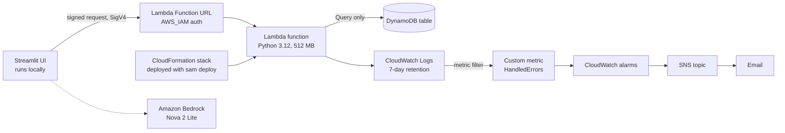

# SME Energy Advisor

Checks small-business electricity bills against Sri Lanka's official tariff, forecasts next month's usage, estimates carbon, and suggests savings. Built as a learning project, with a small serverless backend on AWS that is deployed from code.

> **Data note:** the demo businesses and bills are **synthetic** (invented, and labelled `source=synthetic` in every record). No real customer data is included.

## What it does

- **Bill check:** recalculates a bill from the PUCSL tariff effective 11 May 2026 (general purpose, industrial, hotel; low-voltage supply) and shows the difference from what was charged.
- **Forecast:** a linear-trend forecast of next month's kWh from recent bills.
- **Carbon:** converts kWh to kg CO₂ using Sri Lanka's grid average emission factor.
- **Savings tips:** rule-based, for example when usage sits just over a tariff band threshold (the whole bill is then charged at the higher rate).
- **Advisor agent:** a chat agent on Amazon Bedrock that calls the tools above instead of doing arithmetic itself.

## Architecture



Everything in the stack lives in one region, `ap-southeast-2` (Sydney). Bedrock is called in `us-east-1`. A private, versioned S3 bucket also exists; SAM uses it to upload code, and it was created by hand, so it is not in the template.

## Deploy it

The whole backend is described in `template.yaml` (AWS SAM). One command builds it, and one deletes it.

Prerequisites: an AWS account, the AWS CLI and SAM CLI, and an existing private S3 bucket for uploads. Note that a Free-plan AWS account restricts a project to one region, so check which region yours allows.

```powershell
python scripts/build_lambda.py     # bundles the app code and tariff YAML into lambda_build/
sam deploy --template-file template.yaml --stack-name sme-advisor-stack --region ap-southeast-2 `
  --capabilities CAPABILITY_IAM --s3-bucket <your-private-bucket> --s3-prefix sam-artifacts `
  --parameter-overrides AlertEmail=<you@example.com> --no-confirm-changeset
```

Confirm the subscription email AWS sends, then read the generated names and load the demo data:

```powershell
$table = (aws cloudformation describe-stacks --stack-name sme-advisor-stack --query "Stacks[0].Outputs[?OutputKey=='TableName'].OutputValue" --output text --region ap-southeast-2)
$url   = (aws cloudformation describe-stacks --stack-name sme-advisor-stack --query "Stacks[0].Outputs[?OutputKey=='FunctionUrl'].OutputValue" --output text --region ap-southeast-2)
$env:DYNAMO_TABLE = $table
python scripts/dynamo_demo.py seed
python scripts/call_url.py $url lambda_tariff/business_event.json sme-agent
```

The function URL and resource names are generated, and they change if the stack is rebuilt. Tear everything down with `aws cloudformation delete-stack --stack-name sme-advisor-stack`.

## Testing and deployment

`.github/workflows/ci.yml` runs the tests and a Docker build on every push. Deployment is manual (`sam deploy`, above).

**Why not deploy automatically from GitHub?** I designed it with OpenID Connect, so GitHub could deploy with short-lived credentials and no stored keys (`infra/github-oidc.yaml`, scoped to one repository, one branch and one stack). It cannot be created on this account: AWS's managed policy for Free-plan project accounts denies `iam:*Provider*`, which blocks creating the OIDC provider, and that policy cannot be changed. The alternative, a long-lived access key stored as a GitHub secret, is exactly what OIDC exists to avoid, so I chose manual deploys. On a standard AWS account the template should work as written; note that repositories created after 15 July 2026 use GitHub's immutable subject claim, which includes numeric owner and repository IDs.

## AWS design decisions

| Choice | Why |
|---|---|
| Lambda + Function URL | Stays inside the always-free allowances; no servers to manage. API Gateway has no free tier on a Free-plan account. |
| `AWS_IAM` auth, not public | Every request must be signed, so strangers cannot call it or run up requests. |
| DynamoDB, provisioned 5/5 | Fits the free allowance (on-demand tables get none). Keys: `pk = BIZ#<slug>`, `sk = BILL#<yyyy-mm>`, so "latest bills" is one cheap `Query`. |
| DynamoDB client created during Lambda init | Moves slow setup out of the first request (see results below). |
| Alarm on a custom metric | Lambda's built-in `Errors` metric ignores handled errors that return HTTP 4xx/5xx. The handler logs one marker line per failure and a metric filter counts them. |
| Infrastructure as code | The stack can be rebuilt or deleted with one command, and a change shows up as a reviewable diff before it is applied. |

## Identities and least privilege

| Identity | May do | Cannot do |
|---|---|---|
| `sme-advisor-admin` (IAM user) | Bootstrap and administer the account | Should not run the app |
| `sme-agent` (IAM user) | Call Bedrock, invoke the one function URL, read and write `uploads/*` in the bucket | Anything else (verified: unrelated S3 actions are denied) |
| Lambda execution role (created by the stack) | Write logs, `dynamodb:Query` on its one table | Scan, write, other tables |

## Measured results (Lambda memory tuning)

Same query (`{"business": "sunrise-bakery"}`), measured from CloudWatch `REPORT` lines:

| Setup | Cold total (init + request) | Warm request |
|---|---|---|
| 128 MB, client created on first request | about 2.9 s | not measured |
| 512 MB, client created on first request | 960 ms | 6.2 ms |
| 128 MB, client created during init | 767 ms | 42.9 ms |
| **512 MB, client created during init (chosen)** | **453 ms** | **6.8 ms** |

Single samples, not a benchmark. Init time is billed, and memory also sets CPU, which is why more memory sped up warm calls.

## Run the app locally

```powershell
python -m venv .venv-agent
.venv-agent\Scripts\activate
pip install streamlit boto3 pyyaml strands-agents
$env:SME_LAMBDA_URL = "<function URL from the stack outputs>"
$env:SME_AWS_PROFILE = "sme-agent"
streamlit run glass_app.py
```

The "Check a bill" tab needs no AWS at all. "Cloud data" needs the deployed stack. "Ask the advisor" needs Bedrock access. Tests for the tariff engine and the local API: `pytest`.

## Repository map

```
app/              tariff engine, forecast, carbon, rules, FastAPI + Postgres (local, Docker)
config/           versioned tariff and emission-factor files, with sources
template.yaml     the deployed backend (SAM / CloudFormation)
infra/            docker-compose.yml (local only), github-oidc.yaml (for standard accounts, see above)
lambda_tariff/    Lambda handler and sample events
scripts/          build_lambda.py, dynamo_demo.py, call_url.py
agent/            Bedrock agent and tools
glass_app.py      Streamlit UI
.github/          CI and deploy workflow
docs/sources/     the official PDFs the numbers come from
```

`lambda_build/` and `.aws-sam/` are generated and not committed.

## Limitations and next steps

- **Synthetic data only.** Real bills will probably reveal charges the tariff table does not model, such as taxes or fuel adjustments.
- **Tariff coverage:** only the schedule effective 11 May 2026, and only low-voltage categories. Check PUCSL for newer schedules before relying on results. Bills before that date, or straddling it, are not calculated.
- **Emission factor:** the source report states two different 2022 values (0.4173 and 0.4062 kg CO₂/kWh); 0.4173 is used pending verification.
- **Forecast** is a simple trend line, not a seasonal model.
- **The UI runs only on a laptop.** Hosting it needs a login layer, because a browser cannot safely sign AWS requests.
- **The S3 bucket is created by hand** and is not yet in the template, and nothing reads from it yet.
- **Decider 2B guardrail** (checking that tool arguments came from the user) is written and tested against a mock, but not yet run end to end.
- **Deployments are manual.** A Free-plan account cannot create the OIDC provider that keyless GitHub deploys need (see above).
- **Next:** an upload pipeline from S3 to DynamoDB, validating against real bills, a seasonal forecast, and the guardrail running with the agent.

## Cost

Everything is intended to stay inside AWS always-free allowances, with Bedrock usage covered by Free-plan credits. A zero-spend budget alert is recommended.