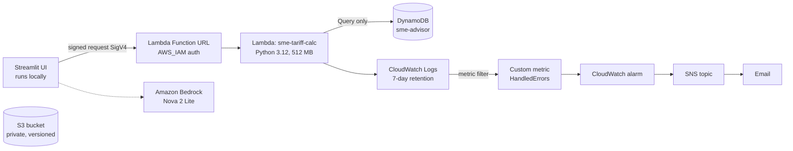

# SME Energy Advisor

Checks small-business electricity bills against Sri Lanka's official tariff, forecasts next month's usage, estimates carbon, and suggests savings. Built as a learning project, with a small serverless backend on AWS.

> **Data note:** the demo businesses and bills are **synthetic** (invented, and labelled `source=synthetic` in every record). No real customer data is included.

## What it does

- **Bill check:** recalculates a bill from the PUCSL tariff effective 11 May 2026 (general purpose, industrial, hotel; low-voltage supply) and shows the difference from what was charged.
- **Forecast:** a linear-trend forecast of next month's kWh from recent bills.
- **Carbon:** converts kWh to kg CO₂ using Sri Lanka's grid average emission factor.
- **Savings tips:** rule-based, for example when usage sits just over a tariff band threshold (the whole bill is charged at the higher rate).
- **Advisor agent:** a chat agent on Amazon Bedrock that calls the tools above instead of doing arithmetic itself.

## Architecture



All resources except Bedrock are in `ap-southeast-2` (Sydney). The S3 bucket exists and is locked down, but no code reads it yet.

## AWS design decisions

| Choice | Why |
|---|---|
| Lambda + Function URL | Stays inside the always-free allowances; no servers to manage. API Gateway has no free tier on a Free-plan account. |
| `AWS_IAM` auth, not public | Every request must be signed, so strangers cannot call it or run up requests. |
| DynamoDB, provisioned 5/5 | Fits the free allowance (on-demand tables get none). Keys: `pk = BIZ#<slug>`, `sk = BILL#<yyyy-mm>`, so "latest bills" is one cheap `Query`. |
| Client created during Lambda init | Moves slow setup out of the first request (see results below). |
| Alarm on a custom metric | Lambda's built-in `Errors` metric ignores handled errors that return HTTP 4xx/5xx. The handler logs one marker line per failure and a metric filter counts them. |

## Identities and least privilege

| Identity | May do | Cannot do |
|---|---|---|
| `sme-advisor-admin` (IAM user) | Build infrastructure | Should not run the app |
| `sme-agent` (IAM user) | Call Bedrock, invoke the one function URL, read/write `uploads/*` in the bucket | Anything else (verified: S3 list and unrelated writes are denied) |
| Lambda execution role | Write logs, `dynamodb:Query` on one table | Scan, write, other tables |

## Measured results (Lambda memory tuning)

Same query (`{"business": "sunrise-bakery"}`), measured from CloudWatch `REPORT` lines:

| Setup | Cold total (init + request) | Warm request |
|---|---|---|
| 128 MB, client created on first request | about 2.9 s | not measured |
| 512 MB, client created on first request | 960 ms | 6.2 ms |
| 128 MB, client created during init | 767 ms | 42.9 ms |
| **512 MB, client created during init (chosen)** | **453 ms** | **6.8 ms** |

Single samples, not a benchmark. Init time is billed, and memory also sets CPU, which is why more memory sped up warm calls.

## Run it locally

```powershell
python -m venv .venv-agent
.venv-agent\Scripts\activate
pip install streamlit boto3 pyyaml strands-agents
$env:SME_LAMBDA_URL = "<your function URL>"
$env:SME_AWS_PROFILE = "sme-agent"
streamlit run glass_app.py
```

The "Check a bill" tab needs no AWS at all. "Cloud data" needs the deployed function. "Ask the advisor" needs Bedrock access. Tests for the tariff engine and API: `pytest`.

## Repository map

```
app/            tariff engine, forecast, carbon, rules, FastAPI + Postgres (local, Docker)
config/         versioned tariff and emission-factor files (with sources)
lambda_tariff/  Lambda handler and IAM policy files
scripts/        build_lambda.py, dynamo_demo.py, call_url.py
agent/          Bedrock agent and tools
glass_app.py    Streamlit UI
docs/sources/   the official PDFs the numbers come from
```

## Limitations and next steps

- **Synthetic data only.** Real bills will probably reveal charges the tariff table does not model, such as taxes or fuel adjustments.
- **Tariff coverage:** only the schedule effective 11 May 2026, and only low-voltage categories. Check PUCSL for newer schedules before relying on results. Bills before that date, or straddling it, are not calculated.
- **Emission factor:** the source report states two different 2022 values (0.4173 and 0.4062 kg CO₂/kWh); 0.4173 is used pending verification.
- **Forecast** is a simple trend line, not a seasonal model.
- **The UI runs only on a laptop;** hosting it is future work.
- **Decider 2B guardrail** (checking that tool arguments came from the user) is written and tested against a mock, but not yet run end to end.
- **Next:** infrastructure as code, GitHub Actions deploy without long-lived keys, real bills, and an upload pipeline from S3 to DynamoDB.

## Cost

Everything is intended to stay inside AWS always-free allowances, with Bedrock usage covered by Free-plan credits. A zero-spend budget alert is recommended.
